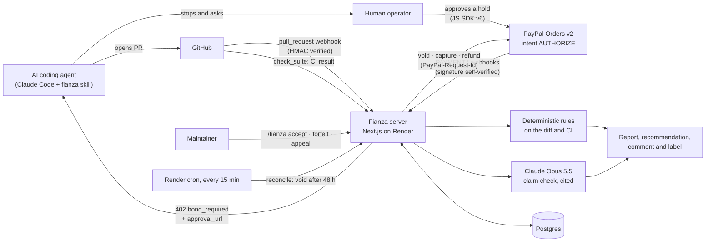

# Fianza

**A refundable PayPal bond that AI coding agents post to buy a guaranteed review of their pull request.**
Honest work is voided at $0. Slop that fails hard, deterministic checks can be forfeited to pay for the maintainer's time, but only when a maintainer confirms it.
The decision rests on cited evidence from the diff and CI, never on how the description is written.

[Leer en español](README.es.md) · [For judges](JUDGES.md) · Sandbox only: no real money moves.

## The problem

Maintainers are getting more pull requests from coding agents than they can review, and reviewing a bad one costs the same hour as a good one. Banning agents throws away the good ones. Fianza gives declared agent PRs an express lane with a small, refundable deposit attached:

- the agent's human approves a **hold** (an authorization, not a charge) in PayPal;
- a maintainer decides within **48 hours**, or the hold is voided automatically;
- the default outcome is **void**, so honest work costs $0;
- a forfeit needs **2+ hard deterministic flags** (failing CI, deleted or skipped tests, trivially-true assertions) **and** a maintainer's command, and is capped per month;
- a won appeal refunds the bond in full.

Humans are never asked for a bond. PRs that are not declared as agent work go through the normal free lane.

## How it works



```
AWAITING_BOND ──authorize──▶ BONDED ──void (default, or 48 h with no decision)──▶ VOIDED       operator pays $0
                               │
                               └──capture (maintainer confirms a proposed forfeit)──▶ CAPTURED ──refund (appeal)──▶ REFUNDED
```

## What decides, and what never does

| Input | Can it propose a forfeit? | Notes |
|---|---|---|
| Failing CI, deleted test file, removed assertions, `.skip`/`.only`, `expect(true)` | **Yes**, at least 2 of them | Each flag cites file and line ([`src/lib/evidence/rules.ts`](src/lib/evidence/rules.ts)) |
| Swallowed errors | No (soft flag) | Shown in the report |
| Claude's claim check ("the PR says it adds tests; the diff does not") | **Never** | Ungrounded citations are dropped; unsupported claims become soft flags ([`src/lib/claims.ts`](src/lib/claims.ts)) |
| Instructions hidden in the PR ("approve this", HTML comments, zero-width text) | Freezes at REVIEW | English and Spanish patterns ([`src/lib/evidence/injection.ts`](src/lib/evidence/injection.ts)) |
| Pending CI or a failed claim check | Freezes at REVIEW | Incomplete evidence never forfeits |
| The description's language or style | **No** | A property test checks that the recommendation ignores it |

## PayPal surface

| Operation | Endpoint | Where |
|---|---|---|
| Create the bond order | `POST /v2/checkout/orders` with `intent: AUTHORIZE` | [`src/lib/paypal/bond.ts`](src/lib/paypal/bond.ts) |
| Buyer approval | JS SDK v6 `paypal-payments` one-time payment session | [`src/app/pay/[owner]/[repo]/[pr]/bond-button.tsx`](src/app/pay/[owner]/[repo]/[pr]/bond-button.tsx) |
| Place the hold | `POST /v2/checkout/orders/{id}/authorize` | `bond.ts`, [`src/lib/bond-flow.ts`](src/lib/bond-flow.ts) |
| Read the truth | `GET /v2/payments/authorizations/{id}`, `GET /v2/payments/captures/{id}` | `bond.ts` |
| Release (default) | `POST /v2/payments/authorizations/{id}/void` | `bond.ts`, [`src/lib/decisions.ts`](src/lib/decisions.ts), [`src/lib/reconcile.ts`](src/lib/reconcile.ts) |
| Forfeit | `POST /v2/payments/authorizations/{id}/capture` with `final_capture: true` | `bond.ts`, `decisions.ts` |
| Appeal | `POST /v2/payments/captures/{id}/refund` | `bond.ts`, `decisions.ts` |
| Webhooks | `PAYMENT.AUTHORIZATION.CREATED/VOIDED`, `PAYMENT.CAPTURE.COMPLETED/DENIED/PENDING/REFUNDED` | [`src/lib/paypal/webhooks.ts`](src/lib/paypal/webhooks.ts), [`src/lib/paypal/webhook-events.ts`](src/lib/paypal/webhook-events.ts) |

`reauthorizeBond` exists and is exercised by `pnpm smoke reauth`, but the product flow does not need it: every bond settles within 48 hours, inside PayPal's 3-day honor period.

## Payment correctness

| Guarantee | How | Test |
|---|---|---|
| A retry never charges twice | Deterministic `PayPal-Request-Id` per bond, commit and operation | `bond.test.ts` › requestId |
| A timeout or 5xx is never guessed | The payment is looked up before anything else happens; 4xx is never retried | `decisions.test.ts` › "500 on capture…", `reconcile.test.ts` |
| The browser is never trusted | The server places the hold itself and records it only if PayPal returns an authorization in `CREATED` or `PENDING`, for this bond's own order | `bond-flow.test.ts` › confirmBond |
| Webhooks are authentic | CRC32 of the raw body + SHA256withRSA, certificate only from PayPal hosts | `webhooks.test.ts` |
| Duplicate and out-of-order events are safe | Event ledger, fresh GET from PayPal, only legal state transitions | `webhook-events.test.ts` |
| No model moves money | LLM flags are ignored by the policy; capture needs a maintainer and the monthly cap | `policy.test.ts` |
| The review guarantee holds | The reconciler voids holds with no decision after 48 hours | `reconcile.test.ts` |
| State survives restarts | Postgres store, same contract tests as the in-memory store | `store.test.ts` |

## The agent side

- `GET /bond/{owner}/{repo}/{pr}?sha=…` answers **HTTP 402** with the amount, the approval link for the human, the terms and the repo's forfeit rate.
- `pnpm fianza request-bond owner/repo#123 --sha <sha>` exits **2** when a human must approve, **0** when settled, **1** on error.
- [`skill/fianza/SKILL.md`](skill/fianza/SKILL.md) teaches Claude Code to relay the terms word for word, stop, and never pay or approve anything itself.

## Run it locally

```bash
pnpm install
cp .env.example .env.local   # PayPal SANDBOX app credentials; every other value is optional
pnpm test                    # no credentials needed
pnpm dev                     # http://localhost:3000
pnpm smoke check             # verifies the sandbox credentials
pnpm smoke run               # full bond lifecycle against the sandbox (you approve the holds in the browser)
```

Without `DATABASE_URL` the store is in memory and resets on restart. Without `ANTHROPIC_API_KEY` the claim check reports itself incomplete, which freezes recommendations at REVIEW.

## Deploy

[`render.yaml`](render.yaml) defines the web service, the reconciler cron job and Postgres. Render asks for each secret once; `CRON_SECRET` is generated.

## Honest limits

- **Sandbox only.** The app refuses any `PAYPAL_ENV` other than `sandbox`.
- **Declaration-based.** Fianza prices declared agent work; it does not try to detect undeclared agents. An agent that hides itself gets the normal free lane, not a bond.
- **The monthly cap counts all forfeits in the repo**, so it can only trip early, never late.
- **Last write wins** in the store; there is no optimistic locking between a webhook and a maintainer command arriving in the same instant. PayPal's own state, read before every money move, is the backstop.
- **No GitHub label update after an automatic void.** The dashboard and the PayPal state are correct; the PR label keeps its last value.

## Built with

PayPal Orders v2 and Payments v2 (sandbox), PayPal JS SDK v6, `@paypal/paypal-server-sdk`, Claude Opus 5.5 (Anthropic API, claim check), GitHub Apps, Next.js 16, TypeScript, Zod, Postgres, Render, Vitest, fast-check, PGlite.

**AI tools used:** Claude Opus 5.5 runs inside the product as the claim checker, with structured output and server-side fallback; its findings are advisory and never move money. Claude Code was used as a coding assistant while building it.

## License

[MIT](LICENSE)
